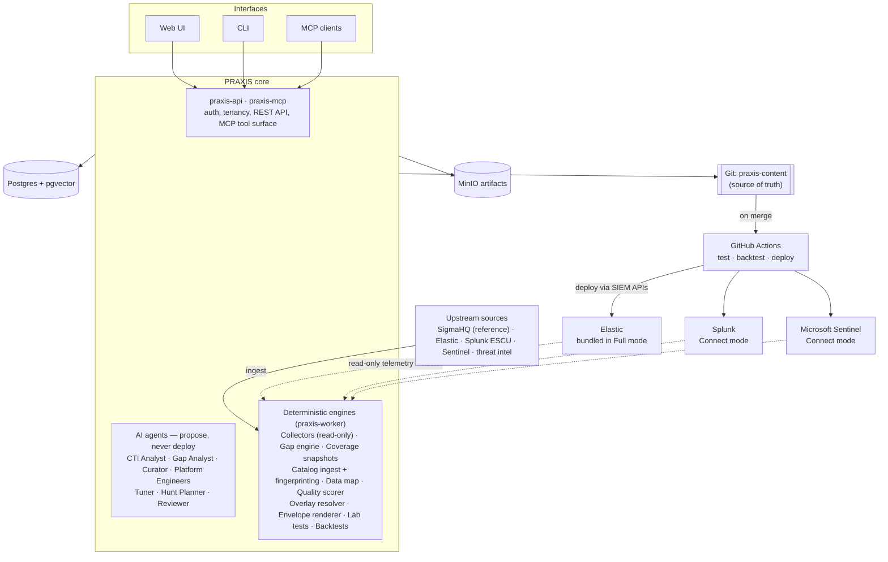
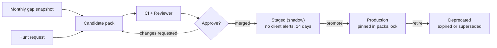

# PRAXIS — Architecture & Build Plan

*Putting theory into practice — turning detection logic into production rules*

Last updated: 2026-11-18 · Living version: https://claude.ai/artifact/RSiP1W7z4PZXYxBJR81sAR

## Vision and principles

PRAXIS is a multi-tenant, AI-driven detection engineering platform: one governed detection library, native to each SIEM and tuned per client, for Elastic, Splunk and Microsoft Sentinel (KQL). It ships monthly rule packs chosen from each client's measured visibility and ATT&CK gaps, plus threat-driven hunt packs. Humans question, review and prompt; deterministic code measures; AI curates, writes and explains.

Design principles:

- **Git is the source of truth.** Every detection, tuning file, pack and client manifest is a file. The UI and CLI are editors over Git, and every change is a pull request.
- **Deterministic first, AI second.** Anything that can be measured (telemetry presence, field population, coverage, FP rate on backtest) is computed by code. The AI reasons over those facts; it never invents them.
- **AI proposes, humans approve, pipelines deploy.** No agent holds deploy credentials. Agents open PRs; CI validates; a reviewer merges; CD deploys.
- **One detection, native everywhere.** A detection's intent, docs and tests are shared; its query is native to each SIEM. Client differences are tuning overlays, never forks.
- **Quality over quantity.** A pack's value is measured in durable, relevant coverage, not rule count.
- **Local first, cloud ready.** Everything is containers and declarative config, so the local server deployment becomes a Terraform/Helm target for AWS, Azure and GCP later.

Out of scope for v1: EDR-native rule targets (CrowdStrike, Defender XDR custom detections), SOAR playbooks, and Google SecOps/YARA-L. The architecture leaves a slot for each as an extra platform implementation.

## What PRAXIS borrows, and what it adds

The detect.fyi article describes a design already running at a four-platform MSSP, so PRAXIS adopts its core ideas as foundations. What makes PRAXIS its own is the layer the article leaves open: measuring each client's visibility and gaps, and turning them into AI-curated packs tuned for each client.

| Idea from the article | How PRAXIS uses it | What PRAXIS adds |
| --- | --- | --- |
| Content packs, plus one client config listing platforms and subscribed packs | Same subscription model, including a Baseline pack every client gets | Monthly rule packs proposed from measured gaps; per-client tuning on shared packs |
| Native rule files as the source of truth; Sigma as reference; AI translates | Native-first: one implementation per SIEM | A shared intent, docs and test events above the native queries, with parity tests so implementations can't drift |
| Docs as code beside each rule, linted in the PR | `README.md` per detection on a linted template | Docs are context for the agents and feed client reports |
| Validation routed by file type and platform, staged in a lab | Same routing and lab staging | Backtests on each client's own data, then shadow mode before alerting |
| Data map: daily table inventory and curated schema notes mapped to ATT&CK data components | Same, per client | Visibility scores and threat-weighted gap classes that drive packs automatically |
| Agent harness: CTI agent, per-platform detection agents, output to a branch | Same agent shape | Quality scoring against generic and over-fitted rules, an independent Reviewer agent, a Tuner |
| Frontend detection grid with alert stats, closure reasons and a gap view | Same views | Multi-client pane of glass and an AI tuning studio |
| Hand-pick rules when adopting (clean slate) | Same principle | AI triage of a client's existing rules: keep, replace or retire |

The one place PRAXIS deliberately departs: the article stores each rule's full platform envelope (ARM template, `.conf`). PRAXIS stores the native query and renders the envelope at deploy time, because per-client tuning has to be injected anyway.

## Architecture at a glance



Everything an agent or human changes lands in Git; GitHub Actions is the only path into a client SIEM, and the dotted lines are the read-only telemetry and health feed back into the gap engine.

## Detection-as-code: repos and the detection model

The query that runs is stored natively in each SIEM's language, and Sigma is reference material. Above the queries sits one shared layer per detection: intent, docs and test events.

Two repositories keep the open-source platform separate from private client content:

- `praxis` (public): platform code, renderers, agents, UI, CLI, deployment.
- `praxis-content` (private, one per MSSP/org): detections, content packs, clients, data maps. `main` is production; all work happens on feature branches.

```
praxis-content/
  detections/
    PRX-000123-lsass-access-comsvcs/
      detection.yml          # intent, ATT&CK, data components, lifecycle, provenance
      README.md              # docs as code: how it works, blind spots, SOC triage
      elastic.esql           # native implementations, any subset of platforms
      splunk.spl
      sentinel.kql
      tests/
        positive/*.json      # events that MUST fire on every implementation
        negative/*.json      # benign look-alikes that MUST NOT fire
      reference/sigma.yml    # upstream Sigma kept for reference, never compiled blindly
  content-packs/
    baseline.yml  windows-endpoint.yml  entra-id.yml  story-ransomware-precursors.yml
  clients/
    acme/
      client.yml             # SIEMs, sector, subscribed packs, client-only detections
      tuning/PRX-000123.yml  # client tuning (see next section)
      datamap/tables.csv     # generated daily: tables/sourcetypes + event counts
      packs.lock             # exact detection versions + tuning hashes deployed
  datamap-catalog/           # curated schema notes per log source, shared by clients
    sentinel/SecurityEvent.md  splunk/wineventlog.md  elastic/logs-endpoint.events.process.md
  overlays/platform/<siem>/  # tuning shared by every client on one SIEM
  threat-profiles/<sector>.yml
  rule-packs/                # monthly and hunt proposals, kept as history
```

**Why native-first.** Translated Sigma is often a weak version of what each SIEM can do (sequences in EQL, `tstats` in Splunk, joins in KQL). Platform agents write and translate implementations, and pySigma is used only for a first draft when a Sigma rule is the starting point. PRAXIS adds **parity tests** on top: every implementation of a detection must pass the same positive and negative events, so the Elastic, Splunk and Sentinel versions can't quietly diverge.

**`detection.yml`** holds a stable ID (`PRX-000123`), a one-sentence intent, ATT&CK techniques and data components, required log sources per platform, Pyramid of Pain tier, quality score, lifecycle state, owner, upstream provenance and licence. Platform envelopes (Kibana rule JSON, a Splunk `savedsearches.conf` stanza, Sentinel analytics rule JSON) are rendered at deploy time from the query, this file and the client's tuning.

**`README.md`** follows a linted template: summary, how it works, blind spots and known gaps, SOC triage guidance, tuning history. CI fails a PR that changes the query without touching the docs' "how it works" section. The UI renders it, and agents read it as context.

## Multi-client tuning: shared packs, per-client overlays

Content packs decide which detections a client gets; tuning overlays decide how each detection behaves for that client. A deployed rule is rendered, not stored, so tuning one client can't leak to another, and a logic fix still reaches everyone.

Resolution order (later layers win):

1. **Native implementation**: `detections/<id>/<platform>.*`.
2. **Platform overlay**: fixes for every client on one SIEM.
3. **Client data map**: that client's index, table and field names.
4. **Client tuning**: `clients/<id>/tuning/<rule-id>.yml`.
5. **Render**: the platform envelope with a content hash, pinned in `packs.lock`.

**Tuning hooks.** Every native implementation must expose a tuning hook; CI fails any that doesn't. Structured overrides are then rendered into each SIEM's own mechanism, so analysts see tuning where they'd expect it:

| SIEM | Hook in the query | Rendered from the client's overrides |
| --- | --- | --- |
| Elastic | None needed | A per-client exception list attached to the rule |
| Splunk | Ends with the macro `praxis_tune_PRX_000123` | That macro's definition in the client's PRAXIS app |
| Sentinel | A `// @praxis:tune` marker line | `where not(...)` clauses inserted at the marker |

Overrides use a closed set of operations, so they are reviewable and machine-checkable:

| Operation | Example | Scope rule |
| --- | --- | --- |
| `exclude` | Parent process is the client's SCCM agent | Rendered via the tuning hook; must cite an alert or ticket |
| `threshold` | 20 failures in 5 min instead of 10 | Numeric fields only |
| `severity` / `risk_score` | High to medium | Logged in coverage weighting |
| `schedule` | Interval 5m to 15m, lookback 20m | Lookback ≥ interval enforced |
| `enabled: false` | Disabled with reason and expiry date | Expired disables come back as tasks |
| `variant` | Client-only implementation with `lineage: PRX-000123` | Last resort; flagged on the dashboard |

```yaml
# clients/acme/tuning/PRX-000123.yml
rule: PRX-000123
reason: "SCCM client spawns PowerShell with -enc during patching"
evidence: ["ALERT-88213", "JIRA-SOC-412"]
author: ai:tuner (approved by lead)
expires: 2027-05-01
exclude:
  - field: process.parent.executable   # logical field; data map resolves per SIEM
    op: endswith
    value: '\CCM\CcmExec.exe'
examples:                              # events this tune exists to silence
  - process: {name: powershell.exe, parent: {executable: 'C:\Windows\CCM\CcmExec.exe'}}
```

Every `exclude` carries `examples`: CI replays them in the lab and requires each to fire on the untuned rule and stay quiet once tuned, so a tune is proven to do what it claims and nothing is excluded on faith.

Three safeguards make shared detections safe to tune:

- **Promotion detection.** When the same exclusion appears for 3 or more clients, the Tuner proposes lifting it into the platform overlay or the detection itself.
- **Override drift.** When a detection's query changes, CI re-tests every client's tuning against it and flags any that no longer apply cleanly.
- **Over-tuning guard.** Each tuning PR shows its backtest impact (alerts suppressed over 30 days). A tune that stops a positive test event from firing fails CI.

## Detection sources and the candidate catalog

PRAXIS pulls from several rule ecosystems so the Curator is never forced to pick a weak Sigma rule just because it's the only option. Every source is ingested into one **candidate catalog**, normalised to the PRAXIS metadata model, and fingerprinted so the same idea from three vendors counts once.

| Source | What it contributes | Ingest as |
| --- | --- | --- |
| SigmaHQ (core, emerging-threats, threat-hunting) | Broad, portable behavioural logic | Reference; pySigma first drafts |
| Elastic `detection-rules` | Mature EQL/ES\|QL, good sequence logic | Native Elastic + logic reference |
| Splunk `security_content` (ESCU) | SPL with analytic stories and test datasets | Native Splunk + attack_data for tests |
| Azure-Sentinel repo | KQL analytics and hunting queries | Native KQL |
| Your IR cases and hunts | Behaviours actually seen in your clients | Written by the Platform Engineer agents |
| Threat intel (MITRE CTI, CISA KEV/advisories, vendor reports, MISP/OpenCTI) | What is being used now, by whom, against which sectors | Context for curation and hunt packs, not rules |
| LOLBAS, LOLDrivers, HijackLibs | Living-off-the-land coverage | Lookup lists and generated rules |
| Atomic Red Team, Splunk attack_data, EVTX samples | Test events, not detections | `tests/positive` |

Normalisation steps for every candidate:

1. Parse to an AST (pySigma for Sigma; per-language parsers for EQL/SPL/KQL).
2. Map to ATT&CK technique and data component, and to required log sources.
3. Compute a **logic fingerprint** (normalised field/operator/value set) to find near-duplicates across sources.
4. Run the deterministic quality scorer (see the AI section).
5. Record provenance, upstream commit and licence. Licences differ (SigmaHQ's DRL, Elastic License 2.0, Apache, MIT), so check terms before redistributing a source's rules to clients.

The catalog lives in Postgres with a vector index (pgvector) on rule descriptions and logic, so agents can search by meaning ("credential dumping via comsvcs") as well as by technique.

## Visibility and ATT&CK gap analysis (deterministic)

The gap engine is pure code and produces the same numbers every run. It answers three questions per client per technique: can we see it, do we detect it, and does it matter to this client.

**1. Telemetry inventory ("can we see it").** A read-only collector queries each SIEM nightly:

- Elastic: data streams, `event.dataset` / `event.module` cardinality, field population rates per dataset.
- Splunk: `| tstats` over index/sourcetype, CIM data model acceleration status, field coverage.
- Sentinel: table list and ingestion volume from the `Usage` table, ASIM parser presence.

Results map to ATT&CK **data components** (e.g. *Process Creation*, *Command Execution*) via a maintained mapping file, in the spirit of DeTT&CT. Each component gets a visibility score of 0–4 from presence, volume stability over 14 days, host coverage (share of assets reporting) and required-field population.

**Data map.** Following the article's data-map idea, the collector writes `clients/<id>/datamap/tables.csv` daily: each table or sourcetype, its event count and hosts reporting. Each log source links to a shared, human-curated schema note in `datamap-catalog/` recording its ATT&CK data components, SIEM field mappings, useful queries and analyst notes. PRAXIS goes further in two ways: when an unknown table appears, an agent drafts its schema note for a human to approve, and the data map feeds the visibility score instead of serving as reference only.

**2. Detection coverage ("do we detect it").** For every deployed rule: technique mapping, quality score, and health from the SIEM (enabled, last run OK, execution errors, alerts in 30 days). A rule that errors or whose data source went silent counts as zero coverage, which catches the "rule exists but is blind" problem.

**3. Threat relevance ("does it matter").** `threat-profiles/<sector>.yml` weights techniques using MITRE group usage for actors known to target that sector and region, CISA KEV/advisories, and your own IR case history. Clients can add crown-jewel context (e.g. "Entra ID is tier 0").

The engine then classifies each technique:

| Class | Meaning | Feeds |
| --- | --- | --- |
| Covered | Visible + healthy, quality-weighted rule | Dashboard only |
| Detection gap | Visible but no adequate rule | Monthly rule pack |
| Visibility gap | Not visible | Onboarding recommendation (e.g. enable Sysmon EID 10) |
| Blind rule | Rule deployed, telemetry missing or rule erroring | Health task, urgent |

Output: a versioned **coverage snapshot** per client (JSON + ATT&CK Navigator layer), stored in Postgres and diffed month on month. This snapshot is the only input the AI Curator receives about a client's environment.

## AI agent layer

Agents work through one tool surface, a **PRAXIS MCP server**, that wraps the platform API: `get_coverage`, `search_catalog`, `score_rule`, `render`, `run_tests`, `backtest`, `propose_override`, `open_pr`, `run_hunt_query` (read-only). Because it's MCP, the same agents run from the CLI, the web UI or Claude Code, and the LLM provider stays swappable. Agents can read and propose; only CI/CD can deploy.

| Agent | Job | Key output |
| --- | --- | --- |
| CTI Analyst | Reads a report or advisory and turns it into detection opportunities and hunt hypotheses | Opportunity list mapped to ATT&CK |
| Gap Analyst | Turns a coverage snapshot into prioritised, explained gaps | Gap brief per client |
| Curator | Searches the catalog, ranks candidates, assembles a pack within budget | Candidate rule pack + rationale |
| Platform Engineers (Elastic, Splunk, Sentinel) | Each knows its SIEM's log sources, style guide and existing detections; searches the repo for similar logic first, then writes, translates and lab-tests implementations | Native implementations + tests on a branch |
| Tuner | Analyses noisy alerts and closure reasons, proposes scoped overrides, spots promotable exclusions | Tuning PR with impact preview |
| Hunt Planner | Turns an actor or threat prompt into hypotheses and per-SIEM hunt queries | Hunt pack |
| Reviewer | Independent critic with no authoring context; challenges every pack and PR | Review comments, pass/fail |

**As built (Phase 3).** The tools live in one registry (`praxis.agents.toolbox`) that the agents call in-process and that `praxis mcp` serves over MCP, so the surface is identical either way. Agents run on the Claude Messages API with a loop PRAXIS hosts, because the tools must reach SIEMs on your network. Opening the pull request is done by code after the guardrails pass, not by an agent tool. Catalog search is Postgres full-text plus ATT&CK filters for now.

### Guardrails against weak and over-fitted rules

The Curator never ranks on its own judgement alone. A deterministic scorer gives every candidate a profile first, and the agent must justify any pick that scores poorly.

| Signal | Too generic looks like | Too narrow looks like |
| --- | --- | --- |
| Specificity | One field, wildcard-heavy (`CommandLine\|contains: 'powershell'`) | Many exact-match literals |
| Pyramid of Pain tier | — | Hashes, IPs, domains, exact file names, one tool's banner strings |
| Durability | — | Tied to a single campaign or CVE with no behaviour; expiry date required |
| Backtest FP rate | High alert volume on 30 days of client data | Zero hits and no positive test events |
| Overlap | Duplicates existing deployed coverage | Fourth rule for the same sub-technique variant |
| Upstream maturity | `experimental`, no FP notes | `experimental`, single author, no references |

Pack-level rules the Curator must satisfy:

- **Budget:** a hard cap per client per month (default 15 rules), so the pack competes on value.
- **Diversity:** at most 2 rules per sub-technique per pack unless the Reviewer approves.
- **Behaviour over artifact:** IOC-tier rules go to a short-lived "threat watch" list with a 90-day expiry, not into the permanent library.
- **Prefer the best implementation:** if Elastic, Splunk and Sigma each have the idea, choose the one with the best tests and backtest result for that client's SIEM.
- **Every pick carries a rationale:** which gap it closes, the threat weight, the score profile and the backtest result. The Reviewer agent and the human see this in the PR.

LLM inputs are minimised: agents get coverage snapshots, aggregated alert stats and sampled, redacted events, never raw bulk logs. Intel reports and upstream rule text are treated as untrusted input, so instructions inside them are ignored and agents cannot act on them.

## Rule-pack lifecycle



Monthly packs and hunt packs share one path: both become a PR, both run in shadow (the rule writes to a PRAXIS-only index or a low-severity tag, not the client's alert queue), and only rules that hold up are promoted.

**Content packs vs rule packs.** A content pack is a standing group of detections that clients subscribe to (Baseline, Windows endpoint, Entra ID, ransomware precursors). A rule pack is a monthly or hunt-driven proposal for one client or sector. It is a PR that may add detections to the library, add them to content packs, change the client's subscriptions or add client-only detections. Once promoted, the rule pack is history; content packs and `packs.lock` hold the live state.

**Monthly cadence (per client):**

1. **Day 1** — nightly snapshot is frozen as the month's baseline; Gap Analyst writes the gap brief.
2. **Days 1–3** — Curator assembles the candidate pack (max 15 rules); Platform Engineers fill gaps no source covers.
3. **Days 3–5** — CI, backtest and Reviewer agent; human review in the Pack review screen.
4. **Days 5–19** — staged in shadow; the Tuner proposes overrides for anything noisy.
5. **Day 20** — promotion PR: rules that stayed quiet or caught true positives go live; the rest are tuned again or dropped with a recorded reason.
6. **Month end** — client report: techniques gained, visibility gaps raised, rules retired.

**Hunt packs (threat-driven):** you prompt, e.g. *"actor targeting Australian healthcare via help-desk social engineering"*. The Hunt Planner pulls the actor's techniques from MITRE CTI and recent reports, checks each client's coverage snapshot, writes hypotheses and per-SIEM hunt queries, and runs them read-only. Findings go to you; hunts that prove durable become detections in a hunt pack, which then enters the same lifecycle. Clients are selected by sector match, so one prompt can fan out to every healthcare client.

Packs are semantically versioned (`acme-2026.12.0`), and `packs.lock` records exactly which detection versions and tuning hashes are live per client.

## CI/CD pipeline (GitHub Actions)

Every change, human or AI, takes the same path: feature branch, PR, checks, required approval, merge to `main` (production). Validation runs on GitHub-hosted runners; anything that touches a SIEM runs on a **self-hosted runner on your local server**, so credentials never leave your network.

**Before commit:** pre-commit hooks for schema, README template, secret scanning and query syntax, so trivial mistakes never reach a PR.

**On pull request (`praxis-ci.yml`):**

1. **Route by change.** Classify changed files by type and platform, so only the affected validators and clients run.
2. **Schema, style and docs.** Validate `detection.yml`, content packs, tuning and client manifests against JSON schema; apply per-platform style rules; lint each README.
3. **Hooks and parity.** Every implementation exposes its tuning hook; every implementation of a detection passes the same positive and negative events.
4. **Render.** Build the platform envelope for every affected client × SIEM.
5. **Lab staging** (self-hosted). Deploy into the lab: Full-mode Elastic, a Splunk container and a lab Sentinel workspace. Replay test events, confirm what fires and what doesn't, then tear down.
6. **Quality gate.** The deterministic scorer runs; scores below threshold need a human `quality-waiver` label.
7. **Backtest** (self-hosted). Run each rendered query read-only against each target client's last 30 days.
8. **PR report.** A bot comment with the coverage diff per client, backtest table, Reviewer-agent verdict and an ATT&CK Navigator layer.

**On merge (`praxis-cd.yml`):**

1. One GitHub **environment per client**, with required reviewers for production clients.
2. Deploy through each SIEM's API, updating rules in place where they exist: the Kibana Detection Engine API for Elastic, a per-client PRAXIS app for Splunk, the Sentinel alert rules API for Sentinel.
3. Deploy only what `packs.lock` pins. The lock (detection version, tuning hash and content hash per rule) is generated by `praxis lock` in the pull request, checked by CI and reviewed like any lockfile; CD refuses a render the lock does not match. (CD does not commit to `main`, which stays protected.)
4. Smoke check after deploy: rule exists, is enabled, and its first run succeeded.

**Nightly (`praxis-nightly.yml`):** drift detection (SIEM state vs `packs.lock`; console edits become a PR or are reverted), data map and coverage refresh, upstream source sync, and expiry checks on disabled and threat-watch rules.

**Pipeline hardening:** branch protection on `main`, required approvers, pinned action versions, workflow linting and secret scanning on every PR.

Rollback is a `git revert` of the merge; CD redeploys the previous rendered hashes.

## Deployment modes: Full and Connect

Both modes run the same PRAXIS core; Full adds a SIEM next to it. Locally everything is Docker Compose with profiles, so one command picks the mode:

```bash
praxis deploy --mode full      # docker compose --profile core --profile elk up -d
praxis deploy --mode connect   # docker compose --profile core up -d
```

| Component | Core (both modes) | Full adds |
| --- | --- | --- |
| `praxis-api` | FastAPI: detections, clients, packs, coverage, auth | — |
| `praxis-worker` | Renderers, collectors, lab tests, backtests, agent runs (queue: Redis) | — |
| `praxis-mcp` | MCP server exposing the API to agents | — |
| `praxis-web` | Next.js UI and pane-of-glass dashboard | — |
| Postgres + pgvector | State, catalog, snapshots, audit log | — |
| MinIO | Artifacts: rendered rules, Navigator layers, reports | — |
| Keycloak | OIDC login, roles, per-client access | — |
| Gitea (optional) | Local Git remote if you don't want GitHub for content | — |
| Elasticsearch + Kibana | — | Single-node or 3-node, TLS on, security enabled |
| Fleet Server + Elastic Agent | — | Endpoint and Windows/Sysmon collection |
| Lab endpoints (optional) | — | Windows/Linux VMs + Atomic Red Team for live validation |

**Connect mode** registers an existing SIEM per client in `client.yml` with two credentials kept apart: a read-only identity for telemetry inventory and backtests, and a deploy identity used only by the CD runner. Connectors:

- Elastic: Kibana API key with detection-rule privileges; Elasticsearch read on the relevant indices.
- Splunk: REST token; a role with `search` on client indexes plus write to one PRAXIS app.
- Sentinel: an Entra app registration with Log Analytics Reader for collection and Microsoft Sentinel Contributor for deploy.

**Adoption.** A client rarely starts empty. PRAXIS imports their existing rules read-only, and the Curator triages each one: keep (adopt it as a PRAXIS detection), replace (a PRAXIS detection does it better) or retire. Cutover runs client by client, with old and new rules side by side in shadow, so detection capability never dips during the move.

**Path to cloud.** The Compose services map one-to-one to a Helm chart. Terraform modules then provide the managed equivalents per cloud: RDS/Cloud SQL/Azure Database for Postgres, S3/GCS/Blob for MinIO, ECS or EKS/GKE/AKS for compute, Secrets Manager/Key Vault/Secret Manager for credentials, and Elastic Cloud or self-managed Elastic for Full mode.

## Web UI, CLI and the pane of glass

The CLI and the web UI are two front ends over the same API and the same agents, so anything you can do in one you can do in the other.

**CLI (`praxis`, Python + Typer, shares the core library):**

```bash
praxis client add acme --siem splunk --sector healthcare
praxis coverage acme --diff last-month          # gap table + Navigator layer
praxis pack plan acme --month 2026-12           # Curator agent builds a candidate pack
praxis hunt "Scattered Spider vs AU healthcare" --clients acme,globex
praxis rule test PRX-000123 --client acme       # render + parity tests + backtest
praxis tune PRX-000123 --client acme --alert ALERT-88213   # Tuner proposes an override
praxis chat                                     # interactive agent session over the MCP tools
```

**Web UI views:**

| View | What it shows | Primary action |
| --- | --- | --- |
| Fleet (pane of glass) | Every client: coverage %, visibility score, blind rules, pack status, noisiest rules, last deploy | Drill into a client |
| Client overview | ATT&CK heatmap (visibility vs detection layers), threat-weighted gaps, telemetry health over time | Request a pack or hunt |
| Pack review | Candidate rules, rationale, score profiles, backtest, Reviewer verdict | Approve, drop or swap rules → PR |
| Tuning studio | Alert sample, rendered rule, override editor, live impact preview | Ask the Tuner, choose scope, open PR |
| Hunt workspace | Hypotheses, per-SIEM queries, results, convert-to-detection | Promote a hunt to a pack |
| Rule library | Every detection, lineage, versions, which clients run which variant | Edit, deprecate |
| Audit | Every agent action, PR, deploy and approval | Export |

**Detection grid.** The Rule library doubles as the SOC's detection grid. Analysts filter by pack, technique or client, see alert volumes per client, and read the rendered README. Each detection also gets an AI summary of how its alerts are usually closed and why, pulled from your case or ticketing system (e.g. Jira, ServiceNow, TheHive). That closure data is also the Tuner's main input.

**The Tuning studio** is the showcase screen. Split view: the alert and its events on the left, the rendered rule in a Monaco editor in the middle, the agent chat on the right. You ask "why is this noisy at Acme?"; the Tuner groups the alerts, proposes an exclusion and shows the scope choice (this client / all Splunk clients / the detection itself). The impact panel then backtests live: "suppresses 412 of 430 alerts over 30 days; all 6 positive tests still fire". One click opens the PR.

**AI in the UI.** The web chat streams from `praxis-api`, which calls the LLM with the MCP tools attached. Users sign in to PRAXIS via OIDC (Keycloak); the LLM provider is configured server-side with an API key, or per user via OAuth where your provider supports it. Role-based access means a client-scoped analyst's agent session can only see that client's data.

## Security, governance and auditability

PRAXIS holds credentials into many client SIEMs, so it is a high-value target and is designed like one.

- **Tenant isolation:** client ID is enforced on every API call and DB row (Postgres row-level security). Agent sessions inherit the caller's scope.
- **Credential split:** read-only collector creds and deploy creds are separate secrets; deploy creds exist only on the self-hosted runner. Secrets in SOPS-encrypted files locally, a vault or cloud KMS later.
- **No agent deploys:** agents have no deploy path. The worst a compromised or confused agent can do is open a bad PR, which CI and a human then reject.
- **Agent sandboxing:** each agent run is a container with no network except the PRAXIS MCP server and the LLM endpoint, a Git token that can only push feature branches, and tools allow-listed per agent role.
- **Untrusted inputs:** upstream rules, intel reports and log events can carry prompt injection. They reach agents as quoted data and cannot widen an agent's tools.
- **Data minimisation to the LLM:** aggregates and redacted samples only; a per-client setting disables external LLM use entirely (local model or deterministic-only mode).
- **Audit trail:** every agent prompt, tool call, PR, approval and deploy is logged with actor (`human:` or `ai:<agent>`), client and content hash. Exportable as evidence for client reporting.
- **Supply chain:** pinned upstream commits, signed commits on `praxis-content`, SBOM and image signing (cosign) for PRAXIS containers.

## Brand, icon and theming

The mark is an original pair of explorer's goggles, not Jak's: those are Naughty Dog's character design, and a public project with your name on it should own its icon outright.

**Icon concept: "the Praxis lens".** A pair of hexagonal goggle lenses joined by a short bridge, seen front-on.

- **Left lens = theory:** a faint grid of small cells, a nod to the ATT&CK matrix.
- **Right lens = practice:** the same grid with one cell lit and a targeting reticle over it, the rule in production.
- Together the two lenses read as a stylised "P" in negative space at small sizes (favicon, CLI banner).
- Variants: full mark with wordmark, lens-only app icon, monochrome for terminal and docs.

**Palette (dark-first, SOC-friendly):**

| Token | Hex | Use |
| --- | --- | --- |
| Obsidian | `#0E1116` | Background |
| Slate | `#1B222C` | Panels, cards |
| Brass | `#D4A24C` | Primary accent, the lit cell, CTAs |
| Signal teal | `#2EC4B6` | Covered / healthy |
| Ember | `#E5533D` | Gaps, blind rules, critical |
| Fog | `#C9D1D9` | Body text |

**Type:** Space Grotesk for headings and wordmark, Inter for UI text, JetBrains Mono for rules and queries.

**UI motifs:** hex cells as the heatmap unit (ties back to the lenses), a subtle "lens focus" animation when a gap turns covered, and a CLI ASCII banner of the lens mark.

## Tech stack and roadmap

| Layer | Choice | Why |
| --- | --- | --- |
| Core language | Python 3.12 | SIEM SDKs, pySigma and agent tooling all live here |
| API / CLI | FastAPI, Typer, shared `praxis-core` package | One codebase, two front ends |
| Workers | Arq or Celery on Redis | Rendering, lab tests, backtests and agent runs are long jobs |
| Rule rendering | Jinja templates per platform envelope; pySigma for first drafts only | Native queries stay as written; only envelopes and tuning are generated |
| Data | Postgres 16 + pgvector, MinIO | Relational state plus semantic search, S3-compatible artifacts |
| Web | Next.js, TypeScript, Tailwind, Monaco, ECharts | Rich editor and heatmaps |
| Agents | MCP server + LLM provider SDK (Claude Agent SDK is a natural fit) | Same tools in CLI, UI and Claude Code |
| Auth | Keycloak (OIDC), RBAC per client | Cloud IdPs drop in later |
| Delivery | GitHub Actions, self-hosted runner, Docker Compose → Helm → Terraform | Local first, cloud ready |

**Build rule: Elastic first.** Elastic is the only SIEM until Phase 5. Every feature in Phases 0–4 is built and proven end to end against Elastic, but always behind the platform interface (`praxis.platforms`): nothing outside a platform module may assume Elastic, and each platform-specific step (query validation, tuning hook, envelope render, lab test, backtest, deploy, collect) is a method on that interface. Phase 5 then adds Splunk and Sentinel as two more implementations, without reworking the core. Until then, "multi-client" means several clients on the bundled Elastic, one Kibana space and one data-stream namespace each.

**Roadmap** — first AI-curated pack lands in week 15; v1.0 ships in week 20; Splunk and Sentinel follow in Phase 5 (indicative, part-time weeks):

| Phase | Weeks | Scope | Gate to pass |
| --- | --- | --- | --- |
| 0 · Foundations | 1–3 | Repos + schemas · native Elastic detections with tuning hooks · CI and docs lint · Full mode (ELK) | A merged PR deploys a tested rule to local ELK |
| 1 · Multi-client core | 4–7 | Content packs + tuning overlays · platform interface · lab tests per client render · Connect mode (Elastic) · CD with `packs.lock` | One rule, tuned differently for 2 clients, live on Elastic |
| 2 · Visibility and gaps | 8–10 | Collectors · data-component mapping · gap engine · Navigator layers · dashboard v1 | Coverage snapshot matches a manual audit of one client |
| 3 · AI agents | 11–15 | MCP server · Curator, Reviewer, Tuner · Pack review + Tuning studio · monthly packs | **First AI-curated pack merged after human review** |
| 4 · Hunts and launch | 16–20 | Hunt Planner + hunt packs · brand and docs · demo video · Helm + Terraform (AWS first) | v1.0 public release on GitHub |
| 5 · More SIEMs | 21–26 | Splunk and Sentinel platform implementations · parity tests across platforms · Connect mode for both | One rule, tuned differently for 2 clients, live on 3 SIEMs |

Each gate is a demo you can post: a short video or write-up per gate builds an audience while you build the product.

**Open questions** (the first is only needed for Phase 5, the second for Phase 3):

- [ ] Test SIEMs: Splunk developer licence for CI containers, and a low-cost Sentinel workspace for deploy tests?
- [ ] Which LLM provider and model for agents, and do any clients require a local-only model?
- [ ] Licence for the public `praxis` repo (Apache-2.0 is the usual choice for adoption)?
- [ ] Synthetic demo clients: build 3 fictional clients (e.g. healthcare, finance, retail) with lab telemetry so the public demo uses no real data?

## Sources and credits

PRAXIS builds on these ideas; credit them in the public README and any write-up.

- [Implementing Detection as Code as a multi-platform MSSP](https://detect.fyi/implementing-detection-as-code-as-a-multi-platform-mssp-6518cc5289b4) (Rcegan, Detect FYI, Nov 2026): content packs, native rule storage, docs as code, data maps, agent harness.
- [Detection Engineering: Practicing Detection-as-Code](https://blog.nviso.eu/series/detection-engineering-practicing-detection-as-code/) (NVISO Labs): content packs and the validation pipeline the article builds on.
- [Cauchy: detection validation](https://blog.cauchy.org/blog/detection-validation): per-sourcetype documentation that inspired the data map.
- [Agentic Threat Hunting Framework](https://github.com/Nebulock-Inc/agentic-threat-hunting-framework): reference design for the Hunt Planner.
