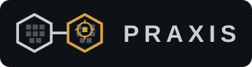

<p align="center"></p>

# PRAXIS

*Putting theory into practice: turning detection logic into production rules.*

PRAXIS is a multi-tenant detection engineering platform. It keeps one governed
detection library in Git, renders each detection natively for a client's SIEM
with that client's tuning, tests it in a lab, and deploys it through CI/CD.
Deterministic code measures visibility and ATT&CK coverage; AI agents curate,
write and explain; humans review and approve.

**Status: v1.0.** Elastic is the only SIEM for now; Splunk, Microsoft Sentinel
and cloud deployment come next. It runs on one server with Docker Compose and
has been proven with fictional clients on lab telemetry, not in production. [PLAN.md](PLAN.md) is the architecture and roadmap, and
[PROGRESS.md](PROGRESS.md) records what is built and proven so far.

## How it fits together

```
content/                       the detections PRAXIS deploys (clients are fictional)
  detections/PRX-000001-*/     detection.yml, README.md, elastic.eql, tests/
  content-packs/               standing groups of detections clients subscribe to
  clients/<id>/client.yml      a client's SIEM, sector and subscribed packs
  clients/<id>/tuning/         that client's tuning, one file per detection
  clients/<id>/packs.lock      exact rule versions and hashes the client runs
  datamap-catalog/             schema notes: what each log source can show
  threat-profiles/             which ATT&CK groups matter to each sector
  sources.yml                  pinned upstream rule sources for the catalog
  rule-packs/                  monthly proposals, kept as history
src/praxis/                    the platform: schemas, renderers, collectors, gap engine, agents, API, CLI
web/                           the dashboard (Next.js)
deploy/                        Docker Compose for the stack and server setup
.github/workflows/             CI on every pull request, CD on merge
```

A pull request is validated (schemas, docs template, ATT&CK ids), rendered for
every client with that client's tuning, and its test events are replayed in a
lab Elastic: positives must fire and negatives must stay quiet. Merging deploys
the rendered rules to each client's Kibana space and checks that every rule's
first run succeeded.

**Tuning without forks.** A client never gets its own copy of a detection. It
gets a small tuning file (`clients/<id>/tuning/<rule>.yml`) with a closed set
of operations: exclude, severity, schedule, disable. Exclusions render to an
exception list on that client's rule only. Each one must cite evidence and
carry an example event, and the lab proves two things on every pull request:
the example is silenced, and every positive test still fires.
`clients/<id>/packs.lock` pins the exact hash of every rule a client runs; CD
deploys nothing the lock does not pin.

**Measured coverage.** A read-only collector inventories each client's
telemetry and rule health. Code then scores visibility per ATT&CK data
component (0 to 4) and puts every technique in one class: covered, detection
gap, visibility gap or blind rule (a rule that is deployed but cannot see or
run). Gaps are ranked by how much the sector's known threat actors use the
technique. The rules are written down in
[docs/visibility-scoring.md](docs/visibility-scoring.md), and the dashboard
shows the result for every client.

**AI that proposes, never deploys.** A Curator agent reads a client's coverage
snapshot and picks rules from a catalog of upstream detections (SigmaHQ and Elastic,
pinned and scored). A Platform Engineer agent turns each pick into a native
detection with docs and tests, and an independent Reviewer agent challenges
the result. Code enforces the rules of the game (budget, no duplicates, no
indicator-only rules, must close a real gap) and measures every score,
backtest and lab result itself. The outcome is a pull request for a person to
review. New rules deploy in shadow mode first. The same tools are available to
any MCP client through `praxis mcp`.

## Quick start

You need [uv](https://docs.astral.sh/uv/) and, for the stack, Docker.

```bash
uv sync
uv run praxis validate            # schemas, README template, ATT&CK ids, tuning hooks
uv run praxis render              # platform envelopes for every client
uv run praxis lock                # refresh packs.lock after changing content
uv run pytest
```

Start the stack on a server (Full mode bundles Elasticsearch and Kibana):

```bash
deploy/server/bootstrap.sh full   # generates deploy/.env with random passwords
```

Lab tests and deploys read their connection from the environment, never from
the repo. For a connection named `lab`:

```bash
export PRAXIS_ELASTIC_LAB_ES_URL=https://localhost:9200
export PRAXIS_ELASTIC_LAB_KIBANA_URL=http://localhost:5601
export PRAXIS_ELASTIC_LAB_CA_CERT=/etc/praxis/ca.crt
export PRAXIS_ELASTIC_LAB_LAB_API_KEY=...       # from `praxis admin provision`
export PRAXIS_ELASTIC_LAB_DEPLOY_API_KEY=...

uv run praxis lab test            # replay test events in the lab SIEM
uv run praxis release acme        # deploy a client's rules and smoke-check them
uv run praxis coverage acme       # collect (read-only) and classify every technique
uv run praxis drift acme          # does the SIEM still match packs.lock?
```

Agents need a model. Run `deploy/dashboard.sh`, open Settings and press
"Sign in with ChatGPT" to use your ChatGPT plan; or use Claude with
`ant auth login` or `ANTHROPIC_API_KEY`. Agents run from your workstation
against the server through SSH tunnels:

```bash
deploy/with-server.sh uv run praxis catalog sync                  # rebuild the candidate catalog
deploy/with-server.sh uv run praxis pack plan acme --month 2026-12 --budget 3
deploy/with-server.sh uv run praxis tune PRX-000002 --client globex
```

The dashboard listens on port 3000 of the server, on localhost only.
`deploy/dashboard.sh` forwards it over SSH and opens http://127.0.0.1:3000.

## Documentation

- [PLAN.md](PLAN.md): architecture and roadmap.
- [PROGRESS.md](PROGRESS.md): what is built, the evidence for each gate, and what is still open.
- [docs/runbook.md](docs/runbook.md): onboard a client and run it, step by step, with the known rough spots.
- [docs/deploying.md](docs/deploying.md): one server with Docker Compose, Kubernetes with Helm, AWS with Terraform.
- [docs/agents.md](docs/agents.md): what each agent does, what code decides for them, and how to run them.
- [docs/visibility-scoring.md](docs/visibility-scoring.md): how visibility is scored and gaps are classified.
- [docs/brand](docs/brand/README.md): the mark, palette and type.

## Credits

PRAXIS builds on ideas from:

- [Implementing Detection as Code as a multi-platform MSSP](https://detect.fyi/implementing-detection-as-code-as-a-multi-platform-mssp-6518cc5289b4) (Rcegan, Detect FYI): content packs, native rule storage, docs as code, data maps, agent harness.
- [Detection Engineering: Practicing Detection-as-Code](https://blog.nviso.eu/series/detection-engineering-practicing-detection-as-code/) (NVISO Labs): content packs and the validation pipeline.
- [Cauchy: detection validation](https://blog.cauchy.org/blog/detection-validation): per-sourcetype documentation behind the data map.
- [Agentic Threat Hunting Framework](https://github.com/Nebulock-Inc/agentic-threat-hunting-framework): reference design for the Hunt Planner.

ATT&CK® data is © The MITRE Corporation, used under the
[ATT&CK terms of use](https://attack.mitre.org/resources/legal-and-branding/terms-of-use/).

## Licence

Apache-2.0. See [LICENSE](LICENSE).
